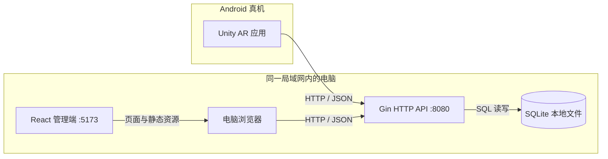
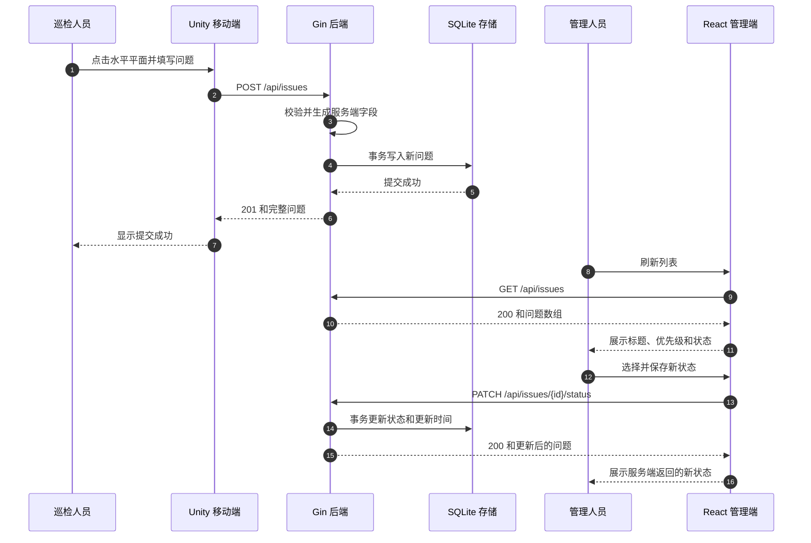
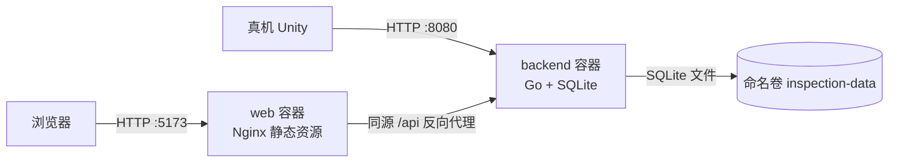

# 现场巡检问题标注架构设计（草案）

> 文档状态：技术方向已确认；工程实施前需锁定依赖版本并按第 13 节检查
> 编写日期：2026-10-26
> 需求依据：`docs/PRD-现场巡检问题标注.md`（已确认）
> 原始约束：`docs/Unity-AR研发实操题-候选人任务书-简略版.md`

## 1. 文档目的与决策边界

本文给出首版原型的技术栈、进程边界、模块职责、接口契约、持久化方式、目录结构和联调方式，供逐项评审。通过后，将确定内容同步到 README 和开发计划。

设计优先级依次为：真实 AR 与三端闭环、真机和重启场景可验证、实现简单且代码易解释、必做内容优先。首版不引入微服务、消息队列、实时推送、账号体系、复杂前端状态管理或加分功能。

### 1.1 本轮已接受的调整

| 项目 | 调整后的方向 |
| --- | --- |
| Go Web 框架 | 使用 Gin；本文将用户所称“Gen”按 Gin 理解 |
| Web UI | 不引入组件库，使用 Tailwind CSS 实现简洁管理台 |
| 样式约束 | 组件使用 Tailwind 工具类，不编写普通 CSS 规则、CSS Modules 或内联样式 |
| Web 包管理 | 使用 pnpm，不使用 npm/yarn 安装或管理项目依赖 |
| UI 参考 | 参考 `../linkseek` 管理台的侧栏、顶栏、卡片、表格和反馈方式，以 React + Tailwind 重写 |
| 时区 | 业务及 API 时间采用北京时间，即固定 UTC+08:00 |
| 交付范围 | 先完成必做内容，加分项不在首版展开 |
| 部署 | 仅用于本地和局域网演示，不公网部署，不进行公网安全方案设计 |

### 1.2 数据库决策

持久化确定为 **SQLite 本地数据库**，不使用 Docker MySQL，也不采用双数据库镜像。

该方案符合任务书“SQLite 或本地 JSON 文件”的约束，并适合快速验证原型：无需额外数据库容器，单表即可保存问题，事务能够覆盖创建和状态修改，Go 重启后重新连接同一文件即可恢复数据。首版不设计多数据库切换能力。

## 2. 技术栈

### 2.1 选型总表

“建议选型”和“已安装版本”分开记录；准确依赖版本在工程创建后通过锁文件确定，并回填 README。

| 部分 | 选型 | 状态与理由 |
| --- | --- | --- |
| Unity 编辑器 | Unity 6 LTS 系列 | 建议；符合 Unity LTS 约束，具体版本待安装后确认 |
| 移动脚本 | C#，Unity 标准 API | 符合固定技术栈 |
| 渲染管线 | Built-in Render Pipeline | 原型无复杂渲染需求，减少管线配置和材质适配 |
| Unity AR 接口 | AR Foundation 6.x | 提供平面检测、射线命中和会话等统一接口 |
| Android AR 提供方 | ARCore XR Plug-in，与 AR Foundation 匹配版本 | 对接 Android 真机 ARCore 能力 |
| AR 运行时 | 真机现有 ARCore 运行时 1.57.0 | 已实测支持，不要求与 Unity 包版本号相同 |
| Unity UI | uGUI、Canvas、EventSystem | 表单和按钮简单，使用引擎自带能力 |
| Unity 网络 | `UnityWebRequest` | Unity 自带 HTTP 能力，适合 Android/IL2CPP |
| Unity JSON | `JsonUtility` + 数据传输对象 | 表达嵌套坐标和列表响应，不增加 JSON 依赖 |
| Android 构建 | ARM64、IL2CPP，最低 Android 7.0（API 24） | 匹配 ARCore 和常见 64 位真机 |
| Go 语言 | Go 1.27.3 | 已通过 Homebrew 安装并执行 `go version` 验证 |
| Go Web | Gin | 按本轮意见采用，提供路由、中间件和 JSON 处理 |
| Go 数据库访问 | `database/sql` | 不引入 ORM，少量 SQL 直观、易解释 |
| 持久化 | SQLite 本地文件，驱动在实现时选择并锁定 | 已确认；符合任务书，无需额外数据库容器 |
| 唯一 ID | `crypto/rand` 生成 UUID 格式字符串 | 无外部 ID 服务，冲突概率可忽略 |
| 业务时区 | 北京时间，固定 UTC+08:00，API 使用 RFC 3339 偏移格式 | 按本轮意见统一，明确传输时区 |
| React | React 19 + TypeScript 5 | 函数组件和 Hooks 足够实现单页列表 |
| Web 构建 | Vite 7 | 开发服务器、环境变量和生产构建，配置量少 |
| Web 包管理 | pnpm 10.21.0 | 已安装；项目锁文件和 `packageManager` 固定实际版本 |
| Web 数据请求 | 浏览器原生 `fetch` | 接口少，不引入 Axios |
| Web 状态 | React Hooks 和组件内状态 | 单页，不引入 Redux 或服务端状态库 |
| Web 样式 | Tailwind CSS | 不使用 Naive UI 等组件库，不编写普通 CSS |
| 通信 | 局域网 HTTP + JSON REST | 共用 Go 后端，首版不需要 WebSocket |
| 当前 Web 环境 | Node.js v24.11.0 | 已在本机确认；npm 不作为项目包管理工具 |
| 包管理 | Unity Package Manager、Go Modules、pnpm | 各技术栈分别锁定依赖 |

### 2.2 关键取舍

| 决策 | 首版方案 | 适用边界 |
| --- | --- | --- |
| Go 框架 | Gin | 路由数量少，仅使用必需能力，不搭建通用 Web 框架 |
| 持久化 | SQLite 本地文件 | 单后端进程、演示数据量；满足重启持久化，不引入数据库容器 |
| 实时更新 | 手动刷新 REST 列表 | 满足刷新后看到新数据，不增加 WebSocket |
| 前端依赖 | `fetch` + Hooks + Tailwind | 只有一个管理页面，不引入 UI 组件库 |
| Unity 渲染 | Built-in Render Pipeline | 只需相机背景、平面可视化和基础几何标记 |
| 后端分层 | 模型/存储/HTTP 三个职责，按需分文件 | 易测试和解释，不设计复杂通用接口层 |
| 开发环境 | 本机 Go、Node.js、pnpm；Docker 已可用 | 不公网部署；本地运行不等于忽略数据持久化 |

## 3. 总体架构

系统由 Android 上的 Unity 应用、电脑上的 Go 服务、电脑上的 Vite/React 管理端组成。Go 是唯一业务写入入口，SQLite 本地文件是唯一持久化存储。



架构边界：

- Unity 负责真实 AR 交互、采集标记位置和上报，不直接访问数据库。
- React 负责展示和状态修改，不在浏览器保存另一份业务数据源。
- Gin 后端负责参数校验、服务端字段生成、状态修改和持久化。
- 成功响应以 Go 返回的数据为准，客户端不伪造 ID、时间或服务端状态。

## 4. 三端模块设计

### 4.1 Unity AR 移动端

| 模块 | 职责 |
| --- | --- |
| AR 会话与相机 | 配置 `ARSession`、`XR Origin` 和 AR 相机；申请相机权限；展示会话或跟踪不可用状态 |
| 平面检测 | 使用 `ARPlaneManager`，仅请求水平平面；使用简单半透明平面 Prefab 展示检测范围 |
| 点击放置 | 使用 `ARRaycastManager` 将屏幕触点射线投射到已检测平面，在命中位置创建或移动当前草稿标记 |
| UI 防误触 | 只处理触摸开始事件；通过 `EventSystem.current.IsPointerOverGameObject(fingerId)` 排除 UI 触摸 |
| 问题表单 | uGUI 输入标题和可选描述，选择优先级；提交前确认已放置标记且标题非空 |
| API 客户端 | 使用 `UnityWebRequest` 发送 JSON；检查 HTTP 状态；解析统一响应；把网络、超时和服务端错误传给 UI |
| 配置 | Inspector 提供默认后端地址，运行时允许修改并保存到 `PlayerPrefs`，避免仅因局域网 IP 改变而重新构建 |
| 页面状态 | 同一时刻只维护一个待提交草稿标记；点击其他平面位置时移动该标记，不生成多条草稿 |

建议使用一个巡检主场景，标记使用球体或立方体 Prefab。提交成功后清除草稿并重置表单；历史标记恢复和编辑不属于首版。

输入建议使用 `UnityEngine.Input` 触摸 API，项目设置启用旧输入管理器或 `Both`，并确保与 UI 输入模块一致。

Android 构建设置必须包含网络和相机权限，并在最终合并的 Manifest 中确认存在 ARCore 包可见性声明：

```xml
<queries>
    <package android:name="com.google.ar.core" />
</queries>
```

如果插件已自动合并该声明，不重复配置。项目不公网部署，后端使用 `http://<电脑局域网IP>:8080`；Android 构建需要允许该开发联调地址的 cleartext traffic，不扩展公网安全设计。

### 4.2 Go 后端

| 目录或文件 | 职责 |
| --- | --- |
| `backend/cmd/server/main.go` | 读取配置、打开存储、注册 Gin 路由、启动和关闭服务 |
| `backend/internal/issue/model.go` | 问题结构、请求结构、优先级和状态校验 |
| `backend/internal/issue/store.go` | 存储接口所需的领域操作和错误，不处理 HTTP |
| `backend/internal/issue/sqlite_store.go` | SQLite 实现，建表、查询、创建、状态修改 |
| `backend/internal/httpapi/handler.go` | Gin 路由、绑定、校验结果映射、统一响应和 CORS |

职责边界：

- HTTP 层不直接拼接 SQL 或操作数据库文件。
- 存储层不处理 HTTP 状态码。
- 所有问题写入经过同一套校验和存储逻辑。
- ID、`createdAt`、`updatedAt` 只能由后端生成或更新。
- 默认监听 `:8080`，即 `0.0.0.0:8080`，供局域网真机访问。
- 启动时完成存储连接和建表；失败时明确报错并停止，不降级成另一份内存数据。

首版只运行一个 Go 进程。SQLite 驱动在工程创建时确定并锁定，不同时维护其他数据库实现。

### 4.3 React 管理端

管理端保持单页，不引入路由：

| 模块 | 职责 |
| --- | --- |
| `types/issue.ts` | 定义 Issue、Position、Priority、Status，与后端字段一致 |
| `api/issues.ts` | 封装基础地址、统一响应解析、列表获取和状态修改 |
| `App.tsx` | 组合管理台布局、列表、刷新、错误和加载状态 |
| `components/AdminShell.tsx` | 侧栏、顶栏、内容区域的 React + Tailwind 实现 |
| `components/IssueList.tsx` | 标题、优先级、状态、更新时间和操作 |
| `components/Feedback.tsx` | 加载、空列表、错误、成功提示 |
| `index.css` | 仅保留 Tailwind 编译入口和必要的 `@theme` 令牌，不写组件 CSS 规则 |

`index.css` 是 Tailwind 必需的编译入口，不是普通 CSS 样式表。所有布局、颜色、间距、字体、边框、交互状态优先使用 Tailwind 工具类；禁止 CSS Modules、`styled-components`、普通组件样式和行内 `style`。动态状态颜色通过完整的静态类名映射，不在运行时拼接 Tailwind 类名。若确有工具类无法表达的需求，优先使用 `@theme` 设计令牌，并在实现前说明，不绕过约束写普通 CSS。

页面加载时请求列表，提供手动刷新。每行使用原生 `select` 和保存按钮，切换选项不立即发请求；保存期间禁用对应控件，成功后以服务端完整问题替换本地行。

后端不可用或请求失败时显示错误和重试入口；已有列表时保留旧数据并标明可能不是最新数据，首次失败也不白屏。首版不做筛选、详情、删除、分页和自动轮询。

### 4.4 linkseek UI 参考范围

已查看 `../linkseek/web/src/views/Layout.vue`、`KeyList.vue`、`Dashboard.vue`。该项目实际使用 Vue + Naive UI，而非 Tailwind，因此不能直接复制其组件代码或依赖。

参考其**信息结构和视觉模式**，不复制具体业务：

- 左侧固定导航区，本项目仅保留“问题列表”一个入口；
- 右侧顶部栏和留白充足的内容区；
- 页面标题与主操作按钮位于同一标题行；
- 主要内容放在简洁卡片中，问题使用表格展示；
- 加载、空状态、错误和成功反馈位置明确；
- 主按钮、状态标签、表格行间距保持克制的管理台风格。

最终用 React 原生元素和 Tailwind 重写，不使用 Naive UI、ECharts、Vue Router，也不加入登录、统计图表等首版无关内容。

## 5. API 契约

### 5.1 通用约定

- 基础路径：`/api`。
- 请求和响应使用 UTF-8 JSON；成功写入响应的 `Content-Type` 为 `application/json`。
- 成功响应为 `{ "data": ... }`；列表的 `data` 始终为数组，空列表不返回 `null`。
- 错误响应为 `{ "error": { "code": "...", "message": "..." } }`。
- `message` 使用可理解的中文；客户端先判断 HTTP 状态，再解析成功或错误结构。
- 创建和状态修改请求拒绝未知字段，尽早发现字段拼写偏差。
- 列表按 `createdAt` 从新到旧返回，同时间按 ID 保证稳定顺序；首版不分页。

### 5.2 接口列表

| 方法与路径 | 请求体 | 成功响应 | 用途 |
| --- | --- | --- | --- |
| `GET /api/health` | 无 | `200`，`data` 为 `{ "status": "ok" }` | 服务及存储可用性检查 |
| `GET /api/issues` | 无 | `200`，`data` 为问题数组 | React 获取已保存问题 |
| `POST /api/issues` | 标题、描述、优先级、位置 | `201`，`data` 为完整新问题 | Unity 上报问题 |
| `PATCH /api/issues/{id}/status` | `{ "status": "in_progress" }` | `200`，`data` 为完整问题 | React 修改状态 |

`GET /api/health` 除了 Gin 进程存活，还执行轻量存储检查；存储不可用时不返回 `ok`。

### 5.3 创建问题

Unity 只发送客户端数据，不发送 `id`、`status`、`createdAt` 或 `updatedAt`：

```json
{
  "title": "入口墙面破损",
  "description": "左侧墙体存在裂缝",
  "priority": "high",
  "position": { "x": 0.42, "y": 0.03, "z": 1.26 }
}
```

后端处理规则：

1. 标题去除首尾空白后不能为空。
2. 优先级必须精确匹配 `low`、`medium`、`high`。
3. 位置必须包含有限数值坐标，不接受 NaN 或无穷值。
4. 描述可选，省略时按空字符串保存。
5. 生成唯一 ID 和北京时间；新问题 `createdAt` 与 `updatedAt` 初始相同，`status` 固定为 `open`。
6. 持久化成功后返回 `201`；写库失败返回服务器错误，不向 Unity 报告成功。

### 5.4 修改状态

状态接口只允许修改 `status`，不允许任意字段覆盖。合法值为 `open`、`in_progress`、`resolved`，首版允许三种状态直接转换。

成功后更新 `updatedAt`，保留 `id` 和 `createdAt`。不存在的 ID 返回 `404 issue_not_found`；非法状态返回 `400 invalid_argument`。

### 5.5 错误约定

| HTTP 状态 | 错误码 | 典型情况 |
| --- | --- | --- |
| `400` | `invalid_argument` | JSON 无法解析、标题为空、枚举非法、字段类型错误 |
| `404` | `issue_not_found` 或 `not_found` | 问题 ID 或 API 路径不存在 |
| `405` | `method_not_allowed` | 已知路径使用不支持的方法 |
| `500` | `internal_error` | 存储读写失败等服务器内部问题 |
| `503` | `service_unavailable` | 健康检查发现存储不可用 |

网络断开、连接失败和超时没有 HTTP 响应，Unity 与 React 必须转换为明确错误提示，不能当作成功或空数据。

## 6. 数据与持久化

### 6.1 SQLite 数据模型

默认数据库为 `backend/data/inspection.db`，不需要 Docker 或其他数据库服务。

使用 `issues` 单表：

| 列 | 类型建议 | 约束 | JSON 字段 |
| --- | --- | --- | --- |
| `id` | `TEXT` | 主键，后端 UUID | `id` |
| `title` | `TEXT` | 非空，应用层校验去空白后非空 | `title` |
| `description` | `TEXT` | 非空，可保存空字符串 | `description` |
| `priority` | `TEXT` | `low/medium/high` 检查约束 | `priority` |
| `status` | `TEXT` | `open/in_progress/resolved` 检查约束 | `status` |
| `position_x` | `REAL` | 非空，有限数值 | `position.x` |
| `position_y` | `REAL` | 非空，有限数值 | `position.y` |
| `position_z` | `REAL` | 非空，有限数值 | `position.z` |
| `created_at` | `TEXT` | 非空，北京时间 RFC 3339 字符串 | `createdAt` |
| `updated_at` | `TEXT` | 非空，北京时间 RFC 3339 字符串 | `updatedAt` |

数据库列使用蛇形命名是存储内部实现，HTTP 三端字段仍严格使用 PRD 的 `position{x,y,z}`、`createdAt` 和 `updatedAt`。位置通过存储映射展开，不改变 JSON 嵌套结构。

建表后创建 `created_at` 与 `id` 的查询索引；首版只有一个表和少量 SQL，不引入迁移框架。建表 SQL 保存于 `backend/internal/issue/schema.sql` 并在启动时执行，保证全新环境可初始化。

### 6.2 读写与重启

- 启动时打开数据库并执行建表和轻量检查，失败则停止启动。
- 查询直接读取同一数据库；列表为空时返回空数组。
- 创建和状态修改使用参数化 SQL，不拼接用户输入。
- 单条写入在事务中执行；事务提交成功才返回成功。
- Go 重启后重新连接同一 SQLite 文件，问题和修改后的状态仍存在。
- 数据库文件、WAL/临时文件不提交 Git。
- 驱动选择和 WAL/ busy timeout 等连接参数在实现时依据驱动文档确定并记录，不在未确认驱动前虚构配置。

本机已有的 Docker MySQL 容器与本项目无关，不连接、不修改，也不作为交付依赖。

### 6.3 北京时间

业务统一使用 `Asia/Shanghai` 的 UTC+08:00 偏移，不引入历史时区换算需求。Go 使用 `time.FixedZone("CST", 8*60*60)` 或明确的固定 +08:00 位置生成时间，格式化为带偏移的 RFC 3339 字符串，例如：

```json
{
  "createdAt": "2026-10-26T20:00:00+08:00",
  "updatedAt": "2026-10-26T20:05:00+08:00"
}
```

存储和 API 均保留 `+08:00`，不使用不带时区的本地时间。React 按原始时间解析并以 `zh-CN` 格式展示，不擅自转换成其他业务时区；Unity 上报不需要传时间。数据库持久化的是明确时间点及约定偏移，不依赖电脑或容器的本地时区设置。

## 7. 核心交互流程



失败时：校验失败返回明确参数错误；写库失败不返回成功；Unity 保留草稿和表单供重试；React 保留服务端原状态并显示错误。

## 8. 配置与运行

### 8.1 配置项

| 配置 | 建议默认值 | 说明 |
| --- | --- | --- |
| Go `ADDR` | `:8080` | 监听所有网卡，供同一局域网真机访问 |
| SQLite `ISSUE_DB_PATH` | `./data/inspection.db` | 相对于从 `backend/` 启动的工作目录（容器内为 `/data/inspection.db`，落命名卷） |
| `INSPECTOR_PASSWORD` / `ADMIN_PASSWORD` | 无默认，必填 | 两个本地演示账号密码（bcrypt 存储），缺失时后端拒绝启动 |
| `SESSION_SECRET` | 无默认，必填 | 会话令牌 HMAC 密钥，至少 32 字符（推荐随机 64 位 hex） |
| `CORS_ORIGINS` | `http://localhost:5173,http://127.0.0.1:5173` | 逗号分隔，按实际 Vite 地址调整 |
| React `VITE_API_BASE_URL` | `http://localhost:8080` | 浏览器与后端同机时使用；Docker 镜像构建时置空走同源代理 |
| Unity 默认 Base URL | 构建时填写电脑局域网地址 | 运行时覆盖值存于 PlayerPrefs |

不包含凭据的配置示例可以提交，本地覆盖配置不提交（`backend/.env`、`compose.local.env` 均在 `.gitignore` 内）。SQLite 自带文件持久化，无需外部数据库服务；容器编排见第 11.3 节。README 需要给出查找电脑局域网 IP、配置 Unity 地址和验证同一 Wi-Fi 的步骤。

### 8.2 本地联调

1. 启动 Go，确认 `http://localhost:8080/api/health` 可访问，并监听 `:8080`。
2. 在 `web/` 使用 `pnpm install` 和 `pnpm dev` 启动 Vite，浏览器通过环境变量访问 Go。
3. 手机与电脑连接同一 Wi-Fi，Unity Base URL 使用电脑局域网 IP，而不是 `localhost`。
4. 先验证手机到后端的局域网连通性，再测试 AR 上报。
5. 若无法访问，检查 IP 变化、同一网络、防火墙和局域网客户端隔离，不用模拟数据掩盖问题。

### 8.3 CORS

Gin 中间件按配置允许 Origin、`Content-Type` 请求头和 `GET/POST/PATCH/OPTIONS` 方法。预检成功返回 `204`，响应包含 `Vary: Origin`。首版不使用 Cookie 或浏览器凭据。

Unity 原生 HTTP 请求不受浏览器 CORS 限制，但仍访问同一 Go 地址。

## 9. 错误、状态与部署边界

### 9.1 客户端状态

- Unity 只有成功命中平面后才允许提交；提交期间禁用提交按钮，防止重复点击。
- Unity 超时建议 10 秒；超时后显示可重试错误，不自动反复提交。
- React 区分首次加载、刷新和单条更新，不把加载中显示为“没有问题”。
- React 不把请求失败等同于空列表。
- 服务端成功前，客户端不把临时状态当作最终服务端事实。

### 9.2 本地部署边界

首版无登录和权限控制，仅用于本地、可信局域网和招聘作业演示，不公网部署。监听 `0.0.0.0` 是为了真机访问；HTTP 明文用于本地联调，不扩展 HTTPS、公网暴露或云部署设计。

不提交 API Key、Token、真实数据库账号或个人隐私。请求体设置合理大小上限，错误响应不泄露本机路径或堆栈，详细服务端错误仅写本机日志。

## 10. 工程目录

### 10.1 目录职责

以下为规划结构，不代表已经创建三端工程：

| 路径 | 内容 |
| --- | --- |
| `unity/Assets/Scenes/` | 巡检主场景 |
| `unity/Assets/Scripts/AR/` | 会话、平面检测、射线放置和 UI 防误触 |
| `unity/Assets/Scripts/API/` | HTTP 客户端、配置和传输对象 |
| `unity/Assets/Scripts/UI/` | 表单、提交结果和运行状态 |
| `unity/Assets/Prefabs/` | 平面和草稿标记 Prefab |
| `unity/Assets/Plugins/Android/` | 必要的 Android Manifest 补充配置 |
| `unity/ProjectSettings/` | Unity 工程设置 |
| `unity/Packages/` | AR Foundation 等包清单与锁定文件 |
| `backend/cmd/server/` | Go 服务入口 |
| `backend/internal/issue/` | 模型、校验、存储与建表 SQL |
| `backend/internal/httpapi/` | Gin 路由、处理器、响应和 CORS |
| `backend/data/` | 未跟踪的本地持久化文件 |
| `web/src/api/` | API 请求与错误转换 |
| `web/src/types/` | TypeScript 类型 |
| `web/src/components/` | 管理台布局、列表和反馈组件 |
| `docs/` | PRD、本文、验证材料和后续记录 |

三端通过实际 JSON 契约联调，不建立共享代码包。Go 结构体、C# 数据传输对象和 TypeScript 类型分别维护，通过统一字段、接口样例和验收用例防止漂移。

### 10.2 规划目录树

为避免纯文本树依赖缩进表达层级，以下用 Mermaid 表达目录关系。节点仅展示预期路径，不是已经存在的工程清单。

```mermaid
flowchart TB
    Root["ar-inspection/"]

    Root --> Docs["docs/"]
    Root --> Backend["backend/"]
    Root --> Web["web/"]
    Root --> Unity["unity/"]
    Root --> Tools["tools/"]
    Root --> Meta["README.md / AI_LOG.md / .gitignore"]

    Docs --> PRD["PRD-现场巡检问题标注.md"]
    Docs --> Architecture["ARCHITECTURE-现场巡检问题标注.md"]
    Docs --> Task["任务书与真机验证材料"]

    Backend --> GoMod["go.mod / go.sum"]
    Backend --> Cmd["cmd/server/main.go"]
    Backend --> Internal["internal/"]
    Backend --> Data["data/（本地数据，不提交）"]
    Internal --> Issue["issue/"]
    Internal --> HTTPAPI["httpapi/"]
    Issue --> Model["model.go"]
    Issue --> Store["store.go"]
    Issue --> SQLiteStore["sqlite_store.go"]
    Issue --> Schema["schema.sql"]
    Issue --> Tests["*_test.go"]
    HTTPAPI --> Handler["handler.go"]
    HTTPAPI --> Middleware["middleware.go"]
    HTTPAPI --> HTTPTests["*_test.go"]

    Web --> WebMeta["package.json / pnpm-lock.yaml"]
    Web --> ViteConfig["vite.config.ts / tsconfig*.json"]
    Web --> IndexHTML["index.html"]
    Web --> EnvExample[".env.example"]
    Web --> WebSrc["src/"]
    WebSrc --> Main["main.tsx"]
    WebSrc --> App["App.tsx"]
    WebSrc --> TailwindEntry["index.css（仅 Tailwind 入口）"]
    WebSrc --> Components["components/"]
    WebSrc --> API["api/issues.ts"]
    WebSrc --> Types["types/issue.ts"]
    Components --> Shell["AdminShell.tsx"]
    Components --> List["IssueList.tsx"]
    Components --> Feedback["Feedback.tsx"]

    Unity --> Assets["Assets/"]
    Unity --> Packages["Packages/manifest.json"]
    Unity --> ProjectSettings["ProjectSettings/"]
    Assets --> Scenes["Scenes/Inspection.unity"]
    Assets --> Scripts["Scripts/"]
    Assets --> Prefabs["Prefabs/"]
    Assets --> Android["Plugins/Android/"]
    Scripts --> AR["AR/"]
    Scripts --> UnityAPI["API/"]
    Scripts --> UI["UI/"]
    AR --> Placement["ARPlacement.cs"]
    AR --> Plane["ARPlaneVisibility.cs"]
    UnityAPI --> Client["IssueApiClient.cs"]
    UnityAPI --> DTO["IssueDtos.cs"]
    UnityAPI --> Config["BackendConfig.cs"]
    UI --> Form["IssueFormController.cs"]
    UI --> Status["StatusView.cs"]

    Tools --> ARCheck["ar-support-check/（既有检测工具）"]
```



SQLite 驱动和具体文件清单在工程创建时锁定；本地数据库及 WAL/临时文件只留在未跟踪的 `backend/data/`，不提交 Git。

## 11. 验证策略

| 层级 | 验证 | 对应风险 |
| --- | --- | --- |
| Go 校验 | 覆盖空标题、非法枚举、默认状态和服务端字段 | 无效数据被保存 |
| Go 存储 | 测试创建/修改后重新连接，事务失败不返回成功 | 重启丢数据或数据不一致 |
| API 联调 | 真实 HTTP 覆盖四个接口、错误结构和 CORS | 客户端与后端契约不一致 |
| Web 构建 | TypeScript 严格检查、Tailwind 编译和 Vite 生产构建 | 类型、样式扫描或打包错误 |
| Web 场景 | 正常列表、刷新、三种状态修改、后端停止后的错误和重试 | 白屏或状态展示不一致 |
| Unity 编辑器 | 编译检查和场景配置检查 | 缺失组件、包或序列化配置 |
| Unity 真机 | 相机、水平平面、射线命中、位置、UI 防误触、成功/失败提示 | 假 AR 或交互不满足任务书 |
| 三端闭环 | 按 PRD 的 AC-01 至 AC-11 逐项验收并录制演示 | 单端可运行但闭环不完整 |

自动化测试主要用于后端核心逻辑和构建检查；真机 AR 和演示视频必须实际执行，不能用单元测试替代。

## 12. 需求追踪

| 架构决策 | 支撑的 PRD 需求 |
| --- | --- |
| AR Foundation + ARCore + 水平平面射线 | AR-01 至 AR-04、AC-01 |
| uGUI、EventSystem 防误触和提交状态 | AR-05 至 AR-07、AC-02、AC-03、AC-05 |
| Gin 统一校验和服务端字段 | API-02、API-05 至 API-07、AC-04、AC-11 |
| 事务持久化和重启重连 | API-08、AC-10 |
| 四个 REST 接口和统一响应 | API-01 至 API-04、WEB-01、AC-06、AC-09 |
| React + Tailwind 管理台和错误反馈 | WEB-02 至 WEB-05、AC-07、AC-08 |
| 单一 Go 数据源、监听和 CORS | API-09、API-10 |
| README、版本回填和真机联调配置 | 交付与演示要求 |

## 13. 已确认决策与实施前检查

已确认的技术决策：

1. 持久化使用 SQLite 本地文件，不使用 MySQL，不设计多数据库切换。
2. 移动端采用 Unity 6 LTS + Built-in + AR Foundation 6.x + ARCore XR Plug-in。
3. 后端采用 Gin + `database/sql`，不引入 ORM。
4. 使用本文的 REST 路径、统一响应和状态子资源接口。
5. 使用 UUID、北京时间 RFC 3339 和服务端字段规则。
6. 管理端采用 React + Vite + pnpm + 原生 fetch + Hooks + Tailwind 的单页方案。
7. 按 linkseek 管理台布局重写，不复制其 Vue/Naive UI 技术栈。
8. Unity 使用 Inspector 默认地址 + PlayerPrefs 运行时覆盖。
9. 首版仅完成必做项，所有加分项后置。

实施前仍需安装 Unity 并确认精确版本，锁定 AR 包、Gin、SQLite 驱动和前端依赖；工程创建后按 README、接口样例和验收场景检查实现是否偏离本文。

当前没有创建三端业务工程，没有创建数据库容器，也没有修改 linkseek 或现有 MySQL 容器。

## 11. 计划 006 架构扩展（2026-10-28 增补）

本节登记计划 006 新增能力的现行架构；前述各节描述的必做闭环架构不变。实施细节与验收以计划文档为准。

### 11.1 账号、会话与授权

新增 `users` 与 `sessions` 两张表，随问题库同库初始化，幂等创建。问题创建人使用独立关联表 `issue_owners` 记录，不改动既有 `issues` 表结构与问题 JSON 契约；旧问题无归属记录，仅管理员可见。

- 密码以 bcrypt 哈希保存；两个演示账号每次启动按环境变量幂等建立或更新。
- 会话令牌为 32 字节随机值，仅在登录响应与 Cookie/Bearer 头中出现；库中只存 `HMAC-SHA256(SESSION_SECRET, token)` 摘要，泄漏数据库也无法伪造令牌。
- 浏览器使用 `HttpOnly`、`SameSite=Lax` 会话 Cookie；Unity 使用 `Authorization: Bearer` 头携带同一令牌（规避 UnityWebRequest 对 Cookie 的不可靠持久化）。后端两种方式等价接受。
- 授权在 HTTP 处理层之前完成：未认证统一 `401 authentication_required`，角色不足统一 `403 permission_denied`；健康检查保持匿名。

### 11.2 实时事件

问题创建与状态修改在事务提交成功后，由后端单进程事件中心向所有管理员 WebSocket 连接广播 `issue.created` / `issue.updated` 事件，正文为完整八字段问题对象加单调递增序号。Go 侧 WebSocket 使用 `github.com/coder/websocket` 库处理帧与生命周期，不自研协议解析。本期单进程、无 Redis；无连接时事件直接丢弃（客户端以全量校准兜底）。

### 11.3 容器拓扑



后端镜像为多阶段构建（固定 Go 工具链编译、非 root 运行）；管理端镜像由 Node/pnpm 构建静态产物后交 Nginx 服务，并把同源 `/api` 请求（含 `/api/ws` 升级）代理到后端容器。两个长期服务加一个 SQLite 命名卷，无其他中间件。真实密码与会话密钥经未跟踪的 `compose.local.env` 注入。2026-10-28 已按此拓扑落地验收（arm64 双镜像、健康检查、全新卷初始化、停止/重启数据保留、局域网直连），详见 `docs/evidence/006-feature-completion/docker-验收记录.md`。

### 11.4 目录增补

| 新增路径 | 职责 |
| --- | --- |
| `backend/internal/auth/` | 账号、会话、密码哈希与授权中间件 |
| `backend/internal/httpapi/ws.go` | WebSocket 升级、连接管理与事件广播 |
| `backend/Dockerfile`、`web/Dockerfile`、`compose.yaml` | 双端生产容器与编排 |
| `unity/Assets/Scripts/UI/`（扩展） | 登录面板、历史面板、完整诊断开关 |
| `tools/issue-reporter/`（扩展） | 登录步骤与会话参数 |
