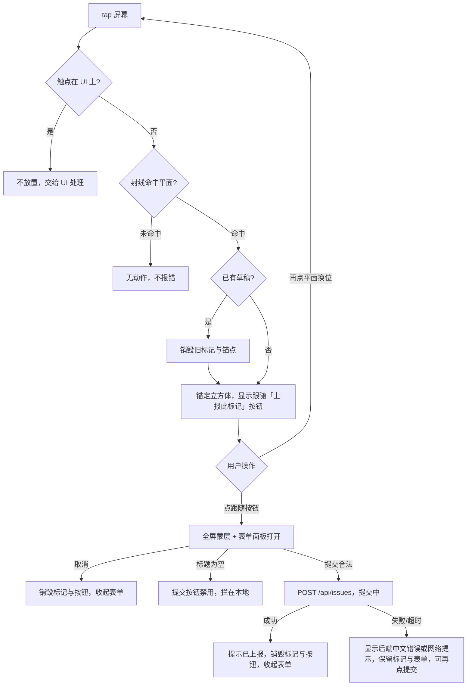

# 计划 004：Unity 真机 AR 放置与上报

> 文档状态：已完成（含已知问题，2026-10-28 用户验收定案；放置位置偏移一项未解决，见施工日志与 README 已知问题）
> 编写日期：2026-10-27
> 前置计划：`docs/plan/001-三端工程骨架搭建计划.md`（工程与配置基础）、`docs/plan/002-Go后端问题业务与持久化计划.md`（HTTP 契约来源）；与 `docs/plan/003-React问题管理与Unity上报模拟工具计划.md`（并行施工中）无目录交集
> 计划范围：Android 构建链路首次验证、平面检测、点击放置标记、移动表单、UI 防误触、HTTP 上报与后端地址运行时配置，及上述各项的真机验收
> 需求依据：`docs/PRD-现场巡检问题标注.md`
> 技术依据：`docs/ARCHITECTURE-现场巡检问题标注.md`

## 1. 计划目标

把 Unity 工程从"可打开、配置齐全的空 AR 场景"推进为"在真机上可完成放置与上报的移动端 App"。本期完成后，仅使用真机 App、Go 后端（已验收契约）就应该能完成：

1. 手机打开 App，授权摄像头后看到实景画面，AR 会话进入跟踪状态。
2. 对准地面缓慢移动，检测出水平平面并有可视化反馈。
3. 手指点击平面，命中位置出现一个立方体标记，钉在地面不随镜头漂移。
4. 放置成功后在标记旁出现「上报此标记」跟随按钮，点击后才打开表单：填写标题（必填）、描述（可选）、优先级（三选一），位置坐标自动带出只读展示；打开表单前可再次点击平面换位调整。
5. 提交后问题经真实 HTTP 写入后端，App 有明确的成功或失败提示；失败可原样重试。
6. 点按钮、输入框、下拉框、键盘时不会误放置标记。
7. 后端地址可在 App 内配置并持久保存，修改局域网 IP 无需重新打包。

本期验收的是 Unity 端 AC-01～AC-05 与后端的数据链路，不包含完整三端联调（AC-06～AC-11 的闭环复核）与演示视频，那些属于下一计划。

## 2. 前置条件与现有成果处理

### 2.1 开工门禁

1. 重读任务书第 3/4 节、PRD 第 6～9 节、架构文档第 4～9 节和本计划全文。
2. 确认计划 002 的后端接口已通过真实进程验收（创建、列表、状态修改、错误契约）；若后端基线异常，先修复后端，不在 Unity 端绕过。
3. 检查 Git 状态与并行会话：计划 003 正在施工 `web/` 与 `tools/issue-reporter/`（当前存在未提交的 `web/package.json`、`web/pnpm-lock.yaml` 改动，归属计划 003 会话）。本计划只修改 `unity/`、`README.md`、`AI_LOG.md`、本计划文档与 `.gitignore`，不得触碰、回退或格式化上述并行改动。
4. 记录环境基线：Unity 编辑器版本与 AR 包版本（以 `Packages/manifest.json` 为准）、JDK/Android SDK/NDK/Gradle 版本（Unity Hub 安装为准）、`adb devices` 能看到 iQOO Z9（V2361A）并已授权调试、手机与电脑同一 Wi-Fi 且互相可达。
5. 复跑工程门禁自检（`Inspection.EditorTools.GateVerify.Run`，当前基线 25/25）并记录结果；已有失败先修复基线。
6. 确认提交信息沿用仓库现有中文说明及 `feat:`、`fix:`、`chore:`、`docs:` 前缀；不自行增加提交规范体系。

### 2.2 已有内容与配置去向

| 已有内容 | 本期处理 |
| --- | --- |
| `Inspection.unity` 场景（AR 会话、AR 相机、仅水平平面检测、射线、锚点管理器、Canvas、EventSystem） | 保留全部管理器配置，在其上挂运行时脚本与 UI，不重建场景 |
| 自定义 Main Manifest（INTERNET 权限 + `com.google.ar.core` queries） | 保留并追加 `android:networkSecurityConfig` 引用（允许开发构建明文 HTTP） |
| `unity/Assets/Scripts/API/IssueDtos.cs`（9 字段完整 DTO 与枚举常量） | 保留用于解析响应；新增仅含 4 客户端字段的创建请求类型，不复用它做请求体 |
| `Assets/Editor/ProjectSetup.cs`、`GateVerify.cs` | 保留；构建脚本与新增自检项按本计划扩展 |
| `tools/ar-support-check/`、`backend/`、`web/` | 完全不动（后端只作为被调用的真实服务） |
| 竖屏方向 | 阶段 1 起锁定 Portrait（Default Orientation），不随设备旋转 |
| 构建产物 | 输出到 `unity/Builds/`（新增 Git 忽略规则），不入库、不交付 |

本期没有旧业务数据、旧场景脚本或旧配置需要迁移。真机本地不保存问题数据；`PlayerPrefs` 只保存后端地址一个配置项，属新增。

## 3. 本期范围

### 3.1 本期做什么

- Android 开发构建全链路首次验证：编辑器构建配置核对、命令行构建脚本、APK 安装到真机、最终合并 Manifest 核对。
- 平面检测可视化：水平平面网格与边界显示，检测/更新/移除的正确性验证。
- 点击放置：屏幕 tap 判定、`ARRaycastManager` 射线命中、立方体标记实例化、`ARAnchor` 锚定、单草稿语义。
- 移动表单：标题/描述/优先级输入、位置只读展示、本地校验、提交与取消。
- UI 防误触：所有 UI 元素上的触摸不触发放置（AC-02）。
- HTTP 上报：`UnityWebRequest` POST 创建接口、统一响应解析、成功/失败反馈与重试、超时处理。
- 后端地址运行时配置：设置面板、`PlayerPrefs` 持久化、未配置时的首次引导。
- 真机与真实后端的联调验收（独立临时数据库与端口），AC-01～AC-05 逐项过验。
- Unity EditMode 自动化测试覆盖 DTO 序列化与响应解析契约。
- README（Unity 启动、后端地址配置、完成状态）、本计划施工日志与 AI_LOG 同步。

### 3.2 本期不做什么

- 不做历史标记恢复、历史问题列表或标记管理（重启后标记消失是预期行为，坐标为会话局部坐标）。
- 不做按优先级/状态改变标记样式、标记点击回看等加分项交互。
- 不支持一次多个未提交草稿；同一时刻至多一个草稿标记。
- 不做 iOS/ARKit、不引入第三方 AR 插件或编辑器 AR 模拟器（编辑器无法验证 AR，一切 AR 验收以真机为准）。
- 不做 Unity 端自动化真机测试框架；交互验收用真机手工步骤 + adb 日志 + 截图证据。
- 不修改 Go 后端接口、数据库与错误码；不改 `web/`、`tools/`（并行计划 003 范围）。
- 不做正式签名、上架、Play 分发；开发构建使用 Unity 默认调试签名。
- 不录制正式演示视频、不做完整三端联调与 AC-06～AC-11 复核（下一计划）。
- 不做登录、权限、筛选、搜索、删除、详情、分页、WebSocket。
- 不推送、不创建 PR、不改写 Git 历史。

## 4. 已锁定的实施方案

### 4.1 技术与工程决策

| 决策项 | 本期规则 |
| --- | --- |
| 触摸输入 | 旧输入 API（`Input.touches`），与工程 `Both` 输入模式和 uGUI EventSystem（Standalone 输入模块）一致 |
| tap 判定 | 单指从按下到抬起：时长 ≤ 500ms 且累计位移 ≤ 24 px（按 1080×2400 屏参照）视为 tap；不满足则忽略 |
| 射线检测 | `ARRaycastManager.Raycast`，命中类型 `PlaneWithinPolygon`，命中即取姿态（位置 + 朝向） |
| 标记外观 | 内建 Cube 打包 Prefab，边长 0.15 米，单色高可见材质（黄色系），无动画无美术加工 |
| 锚定 | 命中姿态经 `ARAnchorManager` 创建锚点，标记作为锚点子物体；AR Foundation 6 的具体锚点 API 以包内文档为准，施工时查证并在日志记录 |
| 草稿语义 | 至多一个草稿标记；草稿存在时再次点击平面 → 销毁旧锚点与标记，在新位置重建；提交成功或点取消 → 销毁并关闭表单；提交失败 → 全部保留可重试 |
| 上报入口 | 放置不直接弹表单：标记在屏幕内时其旁跟随「上报此标记」按钮（屏幕空间，位于标记投影上方并随镜头实时更新，做屏幕边界约束；标记出屏即隐藏、回屏恢复）；点按钮才打开表单；再次点击平面为换位调整（销毁重建） |
| 面板蒙层 | 表单与设置面板打开时显示全屏半透明蒙层遮挡其后内容；蒙层属 UI，触摸不放置、也不关闭面板，关闭面板一律走面板内按钮 |
| 屏幕方向 | 锁定竖屏 Portrait；Canvas 用 Scale With Screen Size 适配 |
| 网络 | `UnityWebRequest` + `JsonUtility`；创建请求体为独立 4 字段类型；列表/状态接口 Unity 端不调用 |
| 超时 | 创建请求 10 秒；超时按失败处理并给出可理解提示，不自动重试 |
| 后端地址 | 运行时设置面板配置，`PlayerPrefs` 持久化；无内置 IP；未配置时首次启动自动弹设置面板（仅一次） |
| 明文 HTTP | 新增 `network_security_config.xml`（允许 cleartext）并在自定义 Main Manifest 引用；该配置随开发构建交付，满足局域网 `http://` 联调 |
| 自动化测试 | Unity Test Framework EditMode 测试，只覆盖 DTO 序列化与响应解析（不模拟 AR、不发真实网络请求） |
| 构建脚本 | 新增 `Assets/Editor/BuildAndroid.cs`：菜单「现场巡检 / 构建 Android 开发包」，也支持 `-executeMethod` 命令行调用；产物 `unity/Builds/inspection-dev.apk` |
| 合并 Manifest 核对 | 用 Android SDK `apkanalyzer manifest print`（不可用时降级 `aapt2 dump xmltree`）核对 INTERNET、CAMERA、`com.google.ar.core` queries、`networkSecurityConfig` 引用 |
| 联调数据 | 后端用独立临时 SQLite 文件与独立空闲端口（沿用计划 002 验收做法），不接触开发者正式数据库 |
| 远程操作 | 不 push、不创建 PR、不改写已有 Git 历史 |

### 4.2 界面结构与交互流程

Canvas 自下而上分四层，全部复用现有 Canvas，不新增第二个 Canvas：

| 层 | 内容与行为 |
| --- | --- |
| 顶部常驻栏 | 左侧后端地址状态（已配置显示地址缩略、未配置显示"未配置后端"）；右侧「设置」按钮打开设置面板；不遮挡放置区域 |
| 跟随上报按钮 | 草稿标记存在且在屏幕内时显示，位于标记屏幕投影上方并实时跟随；点击打开表单面板；标记移出屏幕自动隐藏、回屏恢复 |
| 表单面板（底部卡片 + 全屏半透明蒙层） | 点击跟随按钮打开；含标题输入、描述多行输入、优先级下拉、位置只读行、「提交」「取消」按钮 |
| 设置面板（居中弹窗 + 全屏半透明蒙层） | 后端地址输入框、「保存」「关闭」；保存后立即生效并回写顶部栏 |
| 轻提示区（Toast） | 顶部栏下方，显示提交成功/失败/网络错误等一次性结果文案 |

主交互流程（一条链，无分支遗漏）：

### 4.3 表单与字段规则

| 表单项 | 规则 |
| --- | --- |
| 标题 | 单行输入，必填；按去首尾空白后非空校验，为空时「提交」按钮禁用（后端仍会兜底 400，双保险） |
| 描述 | 多行输入，可空；空则创建请求省略 `description` 字段 |
| 优先级 | 原生 Dropdown，显示「中 / 低 / 高」中文标签，映射 `medium / low / high`，默认 `medium`；不提供非法值选项 |
| 位置 | 只读文本展示 `x / y / z`（保留 3 位小数），取自草稿标记锚定时的世界坐标；不可编辑、不手填 |
| 提交按钮 | 三态：可提交 / 标题为空禁用 / 请求中禁用并显示"提交中…"；防连点 |
| 取消按钮 | 任何时候可点；销毁草稿标记并收起表单，输入内容不保留 |
| 成功提示 | 「问题已上报」；随后表单收起、标记销毁，可直接进行下一次放置 |
| 失败提示 | 优先显示后端 `error.message`（中文）；连接失败/超时显示"无法连接后端，请检查地址与网络"；提示不自动消失，直到下一次提交或取消 |

创建请求体只含 `title / description(或省略) / priority / position{x,y,z}`，与后端契约一致；响应按 9 字段完整结构解析，成功须含非空 `id` 且 `status == "open"`，否则按异常响应处理并提示，不伪造成功。

### 4.4 防误触规则（AC-02）

1. 所有 tap 在进入射线检测前先问 `EventSystem.current.IsPointerOverGameObject(fingerId)`；命中 UI（按钮、输入框、下拉、弹窗、顶部栏）一律不放置。
2. 输入法键盘弹起时的触摸属于 UI 输入，不触发放置。
3. 表单与设置面板打开时全屏半透明蒙层遮挡：蒙层与面板上的任何触摸都不放置（面板存在即冻结放置，避免"想关键盘结果放了个标记"）；蒙层点击不关闭面板，关闭一律走面板内按钮。
4. 跟随上报按钮属 UI 元素，点击它打开表单，不触发放置。
5. 多指触摸、拖动（超 tap 位移阈值）不触发放置。
6. 真机验收覆盖：标题输入框、描述输入框、优先级下拉展开项、键盘弹出区域、提交/取消/设置/跟随上报按钮、蒙层空白处，逐项确认不误放。

### 4.5 后端地址配置

| 项 | 规则 |
| --- | --- |
| 默认值 | 无内置地址；`PlayerPrefs` 无保存值时首启自动弹设置面板一次 |
| 格式 | 用户输入原样保存，使用时去除首尾空白；典型值 `http://192.168.x.x:8080` |
| 校验 | 保存时不强制联网验证（允许离线先填）；提交失败时按连接错误提示，引导回设置检查 |
| 生效 | 保存即生效，无需重启 App；顶部栏同步刷新 |
| 只存一处 | 地址是 App 唯一持久化配置；无账号、无其他偏好项 |

## 5. 目标文件范围

| 路径 | 本期职责 |
| --- | --- |
| `unity/Assets/Scenes/Inspection.unity` | 挂载运行时脚本、UI 层级与 Prefab 引用 |
| `unity/Assets/Scripts/AR/PlacementController.cs` | tap 判定、防误触判断、射线检测、标记实例化与草稿生命周期 |
| `unity/Assets/Scripts/API/IssueDtos.cs` | 新增创建请求类型（4 字段），保留现有完整 DTO 与枚举 |
| `unity/Assets/Scripts/API/IssueApiClient.cs` | `UnityWebRequest` 创建上报、统一响应与错误解析、超时 |
| `unity/Assets/Scripts/API/BackendConfig.cs` | 后端地址存取（`PlayerPrefs`）与格式化 |
| `unity/Assets/Scripts/UI/IssueFormController.cs` | 表单面板：输入收集、本地校验、提交/取消流转 |
| `unity/Assets/Scripts/UI/MarkerReportButton.cs` | 「上报此标记」跟随按钮：屏幕投影跟随、显隐控制、点击打开表单 |
| `unity/Assets/Scripts/UI/SettingsPanelController.cs` | 设置面板：地址编辑保存、首次引导 |
| `unity/Assets/Scripts/UI/ToastView.cs` | 一次性结果提示的显示与清除 |
| `unity/Assets/Prefabs/IssueMarker.prefab` | 立方体标记 Prefab |
| `unity/Assets/Prefabs/PlaneVisualizer.prefab` | 平面可视化 Prefab（网格 + 边界），挂到 `ARPlaneManager` |
| `unity/Assets/Plugins/Android/network_security_config.xml`（res/xml 路径按 Unity Android 插件规范落位） | 允许开发构建明文 HTTP |
| `unity/Assets/Plugins/Android/AndroidManifest.xml` | 追加 `networkSecurityConfig` 引用，其余不动 |
| `unity/Assets/Editor/BuildAndroid.cs` | 命令行与菜单构建入口 |
| `unity/Assets/Editor/GateVerify.cs` | 追加 2～3 项检查（运行时脚本挂载、Prefab 引用、竖屏锁定） |
| `unity/Assets/Tests/Editor/`（含 asmdef） | DTO 序列化与响应解析 EditMode 测试 |
| `unity/ProjectSettings/ProjectSettings.asset` 等 | 竖屏锁定；其余设置维持计划 001 基线 |
| `.gitignore` | 新增 `unity/Builds/` |
| `README.md` | Unity 真机启动、后端地址配置（替换"待实现"节）、完成状态更新 |

## 6. 分阶段施工与门禁

### 阶段 0：前置验收与基线

施工内容：

1. 执行第 2.1 节全部开工门禁并记录结果。
2. 启动真实后端（临时库 + 独立端口），curl 走一遍健康检查与创建接口，确认契约基线。
3. `adb devices` 确认真机在线并已授权；记录手机与电脑 IP，确认互相 ping 通。

阶段门禁：门禁自检 25/25 通过；后端契约基线正常；真机连接与同网段确认；并行会话改动归属明确。

### 阶段 1：Android 构建链路首次验证（最大风险前置）

施工内容：

1. 核对 Player Settings：IL2CPP、ARM64、最低 API 25、竖屏锁定、调试签名、不裁剪（minify 关闭）。
2. 编写 `BuildAndroid.cs` 构建脚本并接入 `.gitignore` 的 `unity/Builds/`。
3. 执行首次真实构建；失败则逐项排障（JDK/SDK/NDK/Gradle 版本、代理与下载地域——注意 Unity 资源下载需非大中华区出口节点），全部过程记入施工日志。
4. `adb install -r` 安装到真机；首次启动完成相机与 ARCore 授权。
5. 空场景 AR 冒烟：看到相机实景、会话状态进入 Tracking、持续运行 ≥ 1 分钟无崩溃。
6. 用 apkanalyzer 打印合并 Manifest，核对 INTERNET、CAMERA、`com.google.ar.core` queries。

阶段门禁：APK 构建成功并可重复（脚本化）；真机冒烟通过；合并 Manifest 四项齐全；`adb logcat -s Unity` 无报错刷屏。

### 阶段 2：平面检测与可视化

施工内容：

1. 制作 `PlaneVisualizer.prefab`（半透明网格 + 边界线），挂到 `ARPlaneManager` 的 plane prefab 槽。
2. 真机验证：对地面缓慢移动后平面出现并随扫描扩展；移除的平面可视化同步消失。

阶段门禁：真机肉眼确认平面网格与实际地面重合，行走绕动时无明显漂移抖动；截图留证。

### 阶段 3：点击放置与防误触

施工内容：

1. 实现 `PlacementController`：tap 判定 → UI 命中判断 → 射线 → 锚定实例化 → 草稿生命周期（重建/销毁）。
2. 制作 `IssueMarker.prefab` 并接入。
3. 真机验证：点击命中出方块、方块钉地不漂移；再次点击平面换位重建、连续快速点击不产生多标记；UI 区域点击不放置（此时可临时放一个测试按钮验证防误触路径，跟随按钮在阶段 4 接入）。
4. `GateVerify` 追加运行时脚本挂载与 Prefab 引用检查项。

阶段门禁：AC-01、AC-02 的核心行为在真机通过；自检项全绿；adb 日志无异常。

### 阶段 4：移动表单

施工内容：

1. 实现跟随上报按钮、表单面板（含蒙层）、设置面板（含蒙层）、顶部栏、Toast 的 UI 与脚本；锁定竖屏下键盘弹出布局可用。
2. 位置只读展示与草稿坐标一致；本地校验与按钮三态。
3. 真机验证：跟随按钮随标记移动、出屏隐藏回屏恢复、点击打开表单；表单完整填写/清空/取消各路径；空标题被本地拦截；下拉展开、键盘弹出与蒙层区域点击不误放置（4.4 节清单逐项）。

阶段门禁：表单全路径真机可用；AC-02 全清单过验；无 UI 穿透放置。

### 阶段 5：HTTP 上报与后端地址配置

施工内容：

1. 实现 `IssueApiClient`（含超时与统一错误解析）、`BackendConfig`、设置面板接线、明文 HTTP 配置（`network_security_config.xml` + Manifest 引用）。
2. EditMode 测试：创建请求序列化恰好 4 字段且 position 嵌套正确；成功/错误/异常响应解析；非法结构不伪造成功。
3. 真机联调（后端临时库 + 独立端口 + 手机填电脑局域网地址）：
   - 正常上报成功：提示出现、curl 列表核对四字段与坐标一致、标记销毁；
   - 空标题（临时绕过本地校验构造）收到后端 400 中文错误并正确展示；
   - 停止后端再提交：连接失败提示、标记与表单保留、恢复后端原样重试成功；
   - 改地址保存立即生效；
   - 重启后端后数据仍在（后端能力，Unity 侧只查询确认）。
4. `README.md`「Unity 真机如何配置 Go 后端地址」一节按真实实现改写。

阶段门禁：EditMode 测试全绿（`-runTests` 批处理执行）；AC-03、AC-04、AC-05 真机逐项通过；联调用 curl/列表接口复核数据一致；截图与关键 logcat 留证。

### 阶段 6：文档同步与交付检查

施工内容：

1. README 更新 Unity 完成状态、启动方式、构建命令、后端地址配置、未完成与已知问题。
2. 更新本计划状态、施工日志（每阶段实际文件、命令、结果、偏差）；按规则维护 `AI_LOG.md`。
3. 检查 `git diff --check`、敏感信息、`unity/Builds/` 与临时数据库未入库、无计划外文件。
4. 仅在用户明确要求时提交；不 push、不创建 PR。

阶段门禁：文档与真实能力一致（不把未验证项写成已完成）；最终汇报含「未按计划实现」「未验证清单」「留下的尾巴」（无则写无）。

## 7. 测试与验收矩阵

| 类别 | 场景 | 预期结果 |
| --- | --- | --- |
| 构建链路 | 命令行重复构建两次 | 两次均成功产出 APK，过程脚本化可复现 |
| 合并 Manifest | apkanalyzer 检查 | 含 INTERNET、CAMERA、ARCore queries、networkSecurityConfig 引用 |
| 会话启动 | 首次启动授权后 | 相机实景 + Tracking 状态稳定 ≥ 1 分钟 |
| 平面检测 | 对地面缓慢移动 | 平面可视化出现、扩展、移除正确，与地面重合 |
| 放置 | 点击检测到的平面 | 命中位置出现黄色立方体与跟随「上报此标记」按钮，钉地不漂移 |
| 放置 | 连续快速点击 | 始终至多一个草稿标记，旧标记被替换 |
| 上报入口 | 点击跟随按钮 / 标记出屏 | 点击后蒙层 + 表单打开；标记出屏按钮隐藏、回屏恢复；打开表单前可换位调整 |
| 放置 | 点击无平面的区域 | 无动作、无报错、无标记 |
| 防误触 | 输入框/下拉/键盘/按钮/跟随按钮/蒙层区域 | 全部不触发放置，蒙层点击不关闭面板（AC-02） |
| 表单 | 标题为空 | 提交禁用；构造绕过后端返回 400 中文错误（AC-04） |
| 表单 | 位置字段 | 与标记锚定坐标一致，只读 |
| 上报 | 合法提交 | 后端保存四字段一致，App 提示成功、标记销毁（AC-03） |
| 上报 | 后端停止后提交 | 明确失败提示，保留标记与表单，恢复后重试成功（AC-05） |
| 上报 | 响应超时（10 秒） | 超时提示，不自动重试，可手动再提交 |
| 上报 | 后端返回异常结构 | 按格式错误提示，不伪造成功、不崩溃 |
| 地址配置 | 首次启动 | 自动弹设置面板一次；保存后顶部栏刷新 |
| 地址配置 | 修改地址保存 | 立即生效，重启 App 后仍保留 |
| DTO 测试 | EditMode 序列化/解析 | 请求体恰好 4 字段；三类响应解析正确 |
| 联调 | 上报后 curl 列表 | ID/标题/描述/优先级/坐标/默认 open 与 App 内一致 |

## 8. 总体验收与需求映射

| 本计划验收 | 对应 PRD | 通过证据 |
| --- | --- | --- |
| 真机平面检测与放置 | AC-01 | 真机操作 + 截图 + logcat |
| UI 防误触 | AC-02 | 4.4 节清单逐项真机验证 |
| 完整问题上报成功 | AC-03 | App 提示 + 后端列表复核 |
| 必填与枚举校验 | AC-04（Unity 侧） | 空标题 400 展示；枚举由 UI 限定 |
| 上报失败提示 | AC-05 | 停后端/超时场景真机验证 |
| Unity 与后端字段契约 | AC-11 的 Unity 部分 | EditMode 测试 + 真实请求体核对 |

AC-06～AC-10 与 AC-11 完整三端一致性属下一计划（三端联调）最终复核；本期只保证 Unity 侧链路正确。

## 9. 风险、降级与偏差处理

| 情况 | 处理方式 |
| --- | --- |
| 首次 Android 构建失败（JDK/SDK/Gradle/网络） | 阶段 1 专职排障，修复优先于一切后续阶段；涉及重新下载 Unity 组件时切非大中华区出口节点；卡点如实记日志，不静默换版本 |
| IL2CPP 构建耗时长 | 每阶段合并验证项减少打包次数；阶段内先用编辑器编译检查（无 AR 的部分）再上真机 |
| 真机跟踪质量差（暗光、弱纹理） | 更换场地重验；属环境限制则记录为已知问题，不硬凑通过 |
| 手机与电脑互不可达（Wi-Fi 客户端隔离） | 换网络/热点；联调端口被占则换空闲端口 |
| 明文 HTTP 仍被系统拦截 | 核对 networkSecurityConfig 是否进入合并 Manifest；未进入则修正插件资源路径后重验 |
| AR Foundation 6 锚点 API 与预期不符 | 以包内文档与官方示例为准实现，差异记施工日志，不改用非官方插件 |
| 编辑器无法验证 AR 导致回归 | 非交互逻辑用 EditMode 测试守契约；交互回归依赖阶段门禁清单逐项重验 |
| 计划 003 并行施工冲突 | 严守目录边界（只碰 `unity/`、README、AI_LOG、`.gitignore`、本计划）；发现对方越界先记录再协调，不代改 |
| 真机授权弹窗自动化受限 | 相机/ARCore 授权为一次性人工步骤，记入未验证清单的兜底说明 |
| 发现计划外问题 | 写入施工日志，不顺手改后端/web 或加功能 |

## 10. 文档维护与施工日志

### 10.1 状态流转

本文顶部状态按 `待评审 → 已确认/待施工 → 施工中 → 待验收 → 已完成` 更新。中止或变更方案时保留原记录并写明日期、原因和影响。

### 10.2 随手同步

- 本计划：每个阶段门禁后追加实际文件、命令、结果、偏差、用户影响和提交 hash；未提交则写"未提交"。
- `README.md`：Unity 真实能力、构建与启动方式、后端地址配置、未完成事项。
- `AI_LOG.md`：按实际顺序保留用户 Prompt 原文和处理结果。
- 架构文档：仅在本期实现确需调整已确认架构时同步，先记录理由。

### 施工日志

- 2026-10-27 / 计划编写：基于计划 001 已完成、计划 002 后端契约可用、计划 003 并行施工中的真实状态编写；前置讨论（AR 概念、会话局部坐标系、上报表单四字段与 JsonUtility 字段忽略限制）已与用户确认。本期只新增计划文档，不改三端代码、不运行工程测试、不提交。
- 2026-10-27 / 评审修改（第 1 轮）：按用户评审意见调整上报交互——放置后不再立即弹表单，改为标记旁「上报此标记」跟随按钮，点击才打开表单，打开前可再次点击平面换位；表单与设置面板增加全屏半透明蒙层防误触，蒙层点击不关闭面板。其余内容维持原稿，状态转为「已确认/待施工」。
- 2026-10-27 / 阶段 0（前置验收与基线）：门禁自检批处理执行 25/25 全过（`Unity -batchmode -executeMethod Inspection.EditorTools.GateVerify.Run` 退出码 0）。后端临时实例（`ADDR=0.0.0.0:18080`、`ISSUE_DB_PATH=~/.ar004-tmp/inspection.db`）复核通过：`/api/health`、创建、列表、空标题 400（`标题不能为空`）、非法枚举 400（`优先级必须是 low、medium、high 之一`）。真机在线：iQOO Z9（V2361A，`adb devices` 已授权），wlan0 `192.168.31.185` 与电脑 `192.168.31.17` 同网段，手机侧 `curl http://192.168.31.17:18080/api/health` 返回 `{"data":{"status":"ok"}}`（手机虽有 VPN tun0，局域网路由不受影响；此前 ping 不通是因为误取蜂窝 rmnet 地址）。环境基线：Unity 6000.3.27f1（AR Foundation/ARCore 6.6.2，manifest.json 为准）、内置 JDK Temurin 17.0.18、Android SDK platforms 34～37 + build-tools 36.0.0、NDK 27.2.12479018（均随 Unity Hub Android 模块安装）。并行归属核查：工作树仅 `AI_LOG.md`（004 评审第 62 条）与本计划文档未提交，均为 004 归属；计划 003 已全部入库（b5f1b34）。
  - 偏差记录（施工环境处置，两笔）：①发现用户有一个自 03:11 起闲置 19 小时的 Unity 编辑器开着本工程（编辑器与批处理互斥），AppleScript 优雅退出 45 秒无响应后以 SIGTERM 退出成功；退出前核对 `git status unity/` 干净、场景文件自 02:39 创建后未改动、工程全部内容已提交 git，判定无未保存工作丢失风险。②期间曾误删其 `Temp/UnityLockfile`（当时误判无编辑器进程），未引发资产冲突，编辑器其后正常退出；后续所有 Unity 操作均在无编辑器实例状态下批处理执行。

- 2026-10-28 / 阶段 1（Android 构建链路首次验证）：新增 `Assets/Editor/BuildAndroid.cs`（菜单「现场巡检 / 构建 Android 开发包」+ `-executeMethod` 批处理共用，开发构建 + LZ4，产物 `Builds/inspection-dev.apk`），`.gitignore` 追加 `unity/Builds/`。首次构建失败暴露两处环境/配置问题并修复：①ARCore 6.6 + Vulkan 要求 minSdk ≥ 29（报错原文 "ARCore Required apps using Vulkan require a minimum SDK version of AndroidApiLevel29"），minSdk 25 → 29（ProjectSettings.asset、ProjectSetup.cs、GateVerify.cs 三处同步；计划原定 24/引擎下限 25，此为第二层偏差，真机 Android 16 无影响）；②合并 Manifest 中 UnityPlayerActivity 被置 `android:enabled=false` 且无 GameActivity（App 无法启动，`am start` 报 Activity does not exist），根因是 Unity 6 新工程默认 Application Entry Point 为 GameActivity（`androidApplicationEntry: 2`）与自定义 Main Manifest 声明的 UnityPlayerActivity 冲突；改 `androidApplicationEntry: 1`（Activity）修复，ProjectSetup.cs 落地该设置、GateVerify 新增对应检查项。修复后连续两次命令行构建成功（首次 355 秒全量、二次 17 秒增量，均退出码 0）。`aapt2 dump xmltree` 核对合并 Manifest：INTERNET、CAMERA、`<queries>` 含 `com.google.ar.core`（另含 ARCore 插件注入的 `com.android.vending`）全部在位，启动 Activity `enabled=true`。真机安装（`adb install -r`）并预授权相机（`pm grant`，规避一次性人工弹窗）；启动成功，AR 会话创建且特性满足（World Facing Camera / Position and Rotation / Plane Tracking / Auto-Focus / Raycast），启动瞬时的 `ArFrame_getHardwareBuffer -12` 报错约 0.4 秒后自行停止，设备截屏证实相机实景正常出图，持续运行 65 秒以上 PID 不变、无 FATAL、无报错刷屏。
  - 降级验证：**「会话进入 Tracking 状态」未验证**——设备静置在桌面无法产生 ARCore 运动跟踪初始化所需的物理移动，AI 会话无法移动真机；相机帧正常与会话配置正确已作为替代证据，Tracking 与平面检测留待用户拿机晃动复核（阶段 5 验收一并处理）。
  - 门禁结论：APK 构建脚本化可重复 ✅；真机冒烟（相机实景 + 无崩溃 ≥ 1 分钟）✅；合并 Manifest ✅；Tracking 状态 ⚠️ 降级（见上）。允许进入阶段 2。

- 2026-10-28 / 阶段 2～5（运行时实现与编辑器验证，一次成批落地后进入真机联调）。新增运行时脚本：`Scripts/AR/PlacementController.cs`（tap 判定/防误触/平面射线/平面附锚/草稿重建，静态 `IsTap` 供测试）、`Scripts/AR/PlaneBoundaryVisualizer.cs`（平面边界描线）、`Scripts/UI/MarkerReportButton.cs`（跟随按钮投影，静态 `ComputeButtonScreenPosition` 供测试）、`Scripts/UI/IssueFormController.cs`（表单/提交/成功销毁草稿/失败保留）、`Scripts/UI/SettingsPanelController.cs`（后端地址 + 首启引导一次）、`Scripts/UI/ToastView.cs`、`Scripts/API/IssueApiClient.cs`（协程 POST、10 秒超时、静态 `ParseCreateResponse` 契约解析）、`Scripts/API/BackendConfig.cs`（PlayerPrefs 持久化）。DTO 调整：`IssuePosition` 由 float 改 double 并按 3 位小数取整（规避 JsonUtility float 序列化噪声 0.42→0.4199999…），新增 `CreateIssueRequest`/`ApiErrorBody`/`IssueApiEnvelope`。测试与工程化：`Inspection.Runtime.asmdef`、`Tests/Editor/Inspection.Tests.Editor.asmdef`、manifest.json 增 com.unity.test-framework 1.5.1；EditMode 测试 23/23 全过（请求体恰 4 字段、响应六类分支、tap 阈值、按钮投影、放置距离/前向校验、地址配置）。场景自动化 `Assets/Editor/SceneWiring.cs`（幂等重建 AppUI：顶部栏/Toast/跟随按钮/表单面板/设置面板含全屏蒙层/调试条，SerializedObject 接线 + UnityEventTools 持久监听）、材质与 Prefab（黄色发光方块 IssueMarker.prefab、半透明青色 PlaneVisualizer.prefab 含边界线）。明文 HTTP：Unity 6 已移除 `Assets/Plugins/Android/res`，改以 AAR 插件（cleartext-config.aar，含 package 属性与 network_security_config.xml）注入；自定义 Main Manifest 增加 `android:networkSecurityConfig` 引用，合并 Manifest 复核在位。门禁自检扩展至 34/34（含运行时接线检查）。
  - 偏差/新增记录（均当场与用户确认或为真机排障最小集）：①`DevDebugOverlay` 调试条为计划外新增（截图 OCR 不可靠，改以 `[ARDebug]` 行写 logcat 供 adb 读取）；②`TorchController` 手电开关为用户授权新增（暗光是平面检测阻塞主因）；③`PlaneBoundaryVisualizer`/材质/asmdef 等文件新增属实现细节自由度；④表单成功提示改为 3 秒自动消失（原计划未定时长）；⑤首启引导曾失效：控制器挂在默认不激活的面板物体上 Start 永不执行，移到常激活的 AppUI 根后修复（真机确认弹窗出现）。

- 2026-10-28 / 真机联调攻坚与验收定案（用户全程逐步配合，问题逐个定位修复）。已解决：①暗光 `InsufficientLight` → 手电开关 + 用户改善环境光后平面检出（平面0 → 平面3+跟踪）；②热节流（`Thermal Status 3 Severe`、电池 40.3°C 导致识别变慢，SoC SM7550 算力经 ARCore SUPPORTED_INSTALLED 认证非瓶颈）→ 新增 `AppFrameRate` 全局 30fps 限帧 + 用户降温、清后台；③跟踪漂移产生伪平面（点击可见桌面命中 8.13m 外、视口 z 为负）→ 放置防线两道：距相机 >2m 拒绝、命中点在相机后方拒绝（`IsPlacementDistanceValid`/`IsPlacementInFront` 静态可测），顶部栏新增「重置」按钮一键 `ARSession.Reset()` 重建地图；④真机相机死后恢复失效（"hardware buffer handle is null" 刷屏、触摸无响应）→ force-stop 重启定位为已知问题（见 README）；⑤adb 无线调试替代数据线（tcpip 5555），后续安装/日志全程无线。**未解决（用户拍板收尾记录）**：AR 虚拟层相对相机画面存在整体向下偏移——点击位置与方块落点不一致、平面可视化与真实地面错位（方块渲染在虚拟平面内自洽、跟随按钮正常）。已排除：算力不足、Vulkan 显示映射（切 OpenGL ES 3.2 后依旧）、渲染管线。定位收窄为 ARCore 相机内参/显示变换映射类问题，本期不再排查，记入 README 已知问题，遗留排查方向：ARCore 相机配置选择（sensor 分辨率/FoV 匹配）、AR Foundation 版本回归、iQOO/Vivo 机型适配。
  - 验收记录（对照 §7 矩阵逐项）：通过——命令行重复构建、合并 Manifest、会话 Tracking、平面检测出现/扩展、放置出现方块+跟随按钮（虚拟层内一致）、单草稿替换、点击无平面无动作（"射线未命中平面"）、UI 区点击不放置（"点击在UI上"）与面板冻结放置（"面板打开，冻结放置"）、表单必填与只读位置、合法提交后端入库（curl 复核 `{"title":"111",...,"position":{"x":-0.039,"y":0.303,"z":1.52}}`，UUID/北京时间/open 默认状态全对，AC-03 ✅）、首启引导弹一次、地址保存重启保留（AC-05 的地址配置部分）、EditMode 23/23、门禁 34/34。部分通过/带已知问题——AC-01 放置功能可用但落点相对点击位置偏移（本节已知问题）；平面与真实地面重合度不达标（同源问题）。**未验证清单**：AC-04 空标题提交（UI 提交按钮禁用已在真机确认禁用态生效，构造请求绕过的 400 展示未真机复验，逻辑有 EditMode 测试覆盖）；AC-05 停后端/超时/异常结构三类失败提示真机未逐项触发（ParseCreateResponse 分支有 EditMode 测试覆盖）；标记出屏按钮隐藏/回屏恢复已实现并在诊断行观察到 `显否/显是` 翻转，未留存截图证据；「钉地不漂移」未做长时间静置量化验证。计划状态流转：施工中 → 已完成（含已知问题）。未提交（待用户指示）。

- 2026-10-28 / 已完成后的放置诊断增量（用户明确授权）：为偏移问题新增成功放置事件记录，仅在开发构建启用；每次锚点与标记创建成功后，在帧末保存同名 PNG 截图和 JSON。记录屏幕尺寸/触点、射线命中点、全部已检平面的边界世界与屏幕坐标、标记与触点偏差、锚点、相机姿态/投影/内参、会话状态和帧号。记录存于应用私有目录，不自动上传、不自动清理；截图含现场实景，导出说明见 README。诊断异常只输出警告，不阻断正常放置与上报。新增 3 项投影/JSON 契约测试，场景门禁增加诊断接线检查；无历史诊断文件迁移，不新增界面与权限，不改变既有放置/上报交互。
  - 范围与降级：本次只增加诊断采集，不宣称修复偏移，不做自动分析、定时截图、远程日志上传与自动清理。真机当时未连接，真实 PNG 内容、文件落盘和坐标对应关系待用户装机点击后复核，不能以编辑器模拟替代。
  - 门禁：EditMode 26/26、GateVerify 35/35 通过；截图/PNG 编码所需的两个官方内置模块已加入依赖，最终 Android 开发构建成功，产物 Builds/inspection-dev.apk，550.6 MB、增量构建 22 秒。README、计划施工日志与 AI_LOG 同步。未安装真机、未提交。

## 11. 后续计划衔接

本计划完成后，下一计划（005）做交付收尾：

1. 完整三端联调：Unity 真机上报 → React 刷新可见 → React 改状态 → 工具/接口复核 → 后端重启数据保留，AC-01～AC-11 全量复核。
2. 两段演示视频（手机端 3～5 分钟、电脑端 3～5 分钟）录制。
3. README 最终收尾与交付检查（敏感信息、Git 历史、仓库完整性）。
4. 加分项在必做闭环稳定后另行评估，不自动进入本序列。
