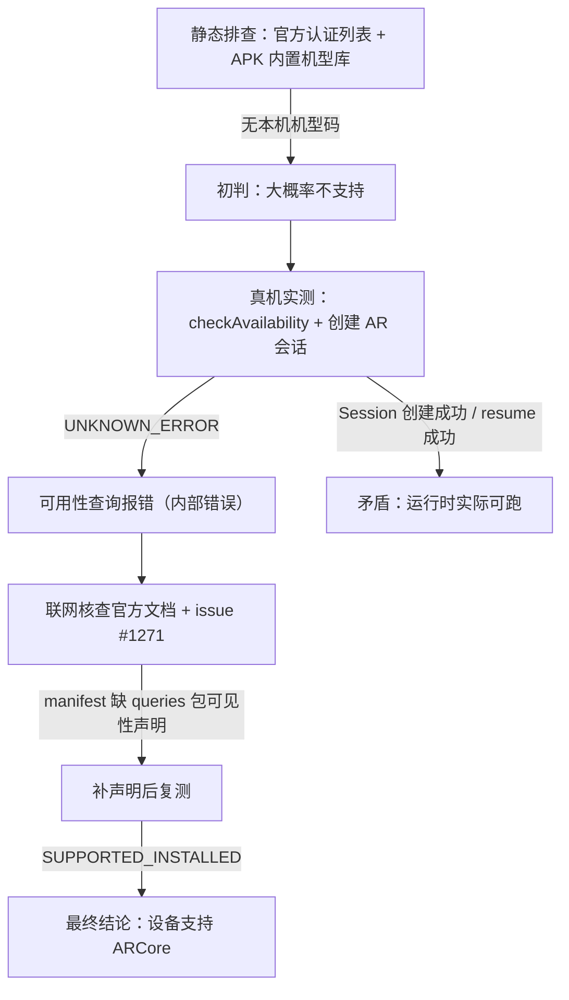

# 真机 ARCore 可行性验证报告

> 验证日期：2026-10-26（作业第 1 天）
> 结论速览：**iQOO Z9 实测可运行 ARCore**，官方运行时判定 `SUPPORTED_INSTALLED`，AR 会话创建、相机启动、运动跟踪全部实测成功。前期"不支持"的判断源于两处误判，本文完整记录了排查与纠错过程。

## 1. 背景

任务书要求 AR 功能"在支持 AR 的真机上运行"，且演示视频须展示"真机识别平面并放置标记"。HR 在任务说明中明确：手机不支持 AR 模块可申请换题。因此在开工前，必须先对开发用真机做一轮可行性验证。

## 2. 验证对象

| 项目 | 值 |
| --- | --- |
| 机型 | iQOO Z9（国行） |
| 型号 / 设备码 | V2361A / PD2361 |
| SoC | 第三代骁龙 7（Qualcomm SM7550） |
| 内存 | 12GB |
| 系统 | Android 16（API 36） |
| ARCore 运行时 | Google Play Services for AR 1.57.0（经 vivo 应用商店安装——Google 官方文档指定的中国区分发渠道之一） |

## 3. 验证方法

不依赖 Unity，直接构建一个最小原生检测 App（源码见 `tools/ar-support-check/`，ARCore SDK 1.57.0，与手机端运行时同版本），依次执行三级验证：

1. `ArCoreApk.getInstance().checkAvailability()` —— ARCore 官方可用性判定；
2. `new Session(context)` —— 真实创建 AR 会话（未认证机型在此步会抛 `UnavailableDeviceNotCompatibleException`）；
3. `session.resume()` + 逐秒采样 —— 实测相机启动与运动跟踪运行。

## 4. 验证过程与发现

### 4.1 排查时间线

1. **静态排查（初判错误）**：Google 官方 [ARCore 支持设备列表](https://developers.google.com/ar/devices?hl=en) 的 Google Play 区与中国区均无 iQOO Z9；拆解手机上已安装的 ARCore APK，其内置 vivo 机型库（仅 PD20xx/PD21xx 旧机型）中无本机机型码。据此初判"大概率不支持"。
2. **真机实测（出现矛盾）**：检测 App 运行后，`checkAvailability` 返回 `UNKNOWN_ERROR`，但 **AR Session 创建成功**、`resume()` 成功（相机启动、跟踪运行）——静态结论与运行时表现直接矛盾。
3. **根因定位**：联网核查确认 `UNKNOWN_ERROR` 的官方定义为"确定可用性时发生**内部错误**"（非设备判定），并结合 [arcore-android-sdk issue #1271](https://github.com/google-ar/arcore-android-sdk/issues/1271)（Google 工程师确认）定位真因：Android 11+ 包可见性限制——侧载安装且 targetSdk ≥ 30 的 App，manifest 缺少 `<queries>` 声明时，可用性查询会被系统拦截并报 `UNKNOWN_ERROR`。检测 App 恰好命中全部条件，**与网络/VPN 无关**。
4. **修复复测**：manifest 补充声明后重新打包（其余代码零改动），`checkAvailability` 返回 **`SUPPORTED_INSTALLED`**，矛盾消除。

### 4.2 排查路径



### 4.3 修复用到的 manifest 声明

```xml
<!-- Android 11+ 包可见性声明：允许 App 查询 com.google.ar.core 包（修复 UNKNOWN_ERROR 的关键） -->
<queries>
    <package android:name="com.google.ar.core" />
</queries>
```

## 5. 关键问题解释

### 5.1 Play 商店为何显示"已不再与您的设备兼容"

Play 商店列表页的兼容性判定走 **Play 分发目录**（要求机型"出厂自带 Play 商店"，国行型号不在其中），属于**渠道分发判定**；而设备能不能跑 AR 取决于 **ARCore 运行时判定**，两者是独立体系。本机 ARCore 由 vivo 应用商店（官方中国区渠道）安装，运行时判定为支持。佐证截图见 `docs/evidence/`。

### 5.2 检测中唯一的"失败"项：MissingGlContextException

`session.update()` 采样帧数据时报 `MissingGlContextException`，原因是检测 App 为裸 Activity、未创建 OpenGL 上下文（ARCore 出帧接口需要 GL 环境），**属检测工具自身限制，与手机能力无关**。Unity 工程天然具备 GL 上下文，不受影响。

### 5.3 静态排查为何误判

官方认证列表与 APK 内置库反映的是"分发目录"与"出厂内置数据"；ARCore 的设备配置文件支持 OTA 更新，运行时会按设备码动态加载。目录里没有 ≠ 运行时不能跑，最终以运行时实测为准。

## 6. 最终结论

| 检测项 | 结果 | 判定 |
| --- | --- | --- |
| `checkAvailability`（修复 manifest 后） | `SUPPORTED_INSTALLED` | ✅ 支持 |
| AR Session 创建 | 成功 | ✅ |
| `Session.resume()`（相机启动 + 运动跟踪） | 成功，跟踪数据正常产出 | ✅ |
| 平面检测实际效果 | 待 Unity 首次真机构建确认 | ⏳ 非风险项 |

对作业的影响：无需换题、无需额外设备；真机部署走 adb 侧载，不依赖 Play 商店；Unity AR Foundation 打包时自动生成包含所需声明的 manifest，本报告 4.3 节的坑对 Unity 路线天然免疫。

## 7. 证据索引

| 文件 | 内容 |
| --- | --- |
| `tools/ar-support-check/results/01-首测-会话创建成功.png` | UNKNOWN_ERROR 与 Session 创建成功的矛盾现场 |
| `tools/ar-support-check/results/02-增强测-相机跟踪启动成功.png` | resume 成功、相机跟踪运行 |
| `tools/ar-support-check/results/03-修复manifest后-官方判定SUPPORTED_INSTALLED.png` | 补 queries 声明后复测结果 |
| `docs/evidence/AR检测-Play商店判定-不兼容.png` | Play 商店"已不再兼容"提示（渠道判定） |
| `docs/evidence/AR检测-vivo商店页面-对比.jpg` | vivo 应用商店 ARCore 安装页对照 |

## 8. 复现方式

前提：手机已安装 ARCore 运行时（vivo 应用商店搜索 ARCore / 谷歌 AR 服务），USB 调试已连接。

```bash
cd tools/ar-support-check
./gradlew assembleDebug
adb install -r app/build/outputs/apk/debug/app-debug.apk
adb shell pm grant com.holocode.archeck android.permission.CAMERA
adb shell am start -n com.holocode.archeck/.MainActivity
```

注意：vivo 系统默认限制第三方应用的 logcat 输出，结果以 App 屏幕显示为准（可 `adb exec-out screencap -p` 截屏留档）。

## 参考

- [ArCoreApk.Availability 官方文档（UNKNOWN_ERROR 定义）](https://developers.google.com/ar/reference/java/com/google/ar/core/ArCoreApk.Availability)
- [arcore-android-sdk issue #1271（包可见性导致 UNKNOWN_ERROR）](https://github.com/google-ar/arcore-android-sdk/issues/1271)
- [arcore-android-sdk issue #485（"已安装即视为支持"的官方说明）](https://github.com/google-ar/arcore-android-sdk/issues/485)
- [ARCore 支持设备列表](https://developers.google.com/ar/devices?hl=en)
